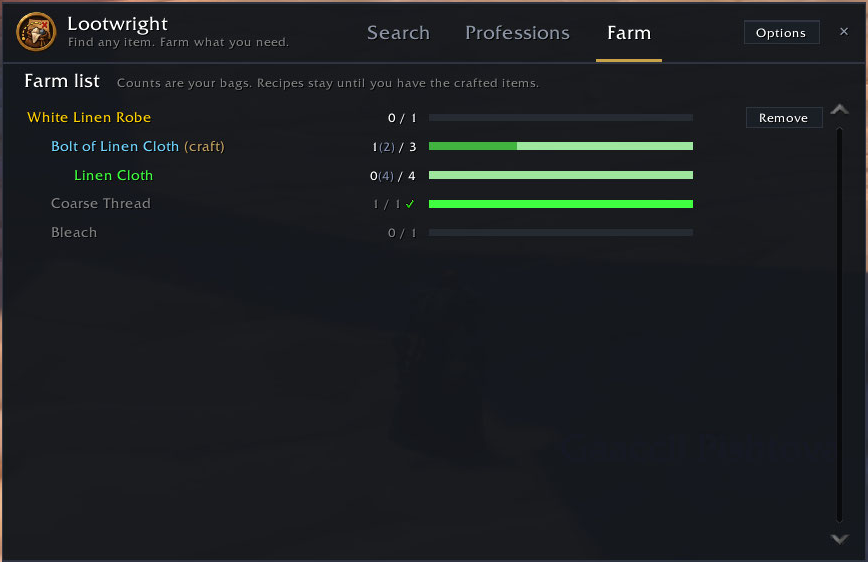

# Lootwright

**Find any item. Farm what you need.** A free addon for **WoW Forever**: type an item's name and see every mob that drops it, where they are, what level they are and how often it drops. Put it on your farm list with a goal, and the mobs you need get pins on your map and a line on their tooltip until your bags hold enough.

**Download:** [CurseForge](https://www.curseforge.com/wow/addons/lootwright) (needs [QuestieDB](https://www.curseforge.com/projects/1696795), not Questie itself)



## What it does

- **Search any item** and see every mob that drops it: level, rank, zone and drop rate, best rates first and your zone on top. Filter by reagents, quest items, gear, other or dungeon drops.
- **Farm with goals:** choose how many you want; mobs that drop it get map pins and a "Farm:" tooltip line until you have enough.
- **Farm a whole recipe:** every material becomes a goal, crafted materials open up into what they're made from (if you have the profession), and you're told when you can craft. Items in your bank show in the count.
- **Farm tracker** on screen, with bank counts.
- **Every recipe** for every profession, including the ones you haven't learned.
- **Honest drop rates:** dungeon boss rates measured in Forever (ForeverDB.net), rough Classic rates for normal mobs marked with `~`, and "rate unknown" instead of a guess.

Type `/if` in game, or click the minimap button. `/if help` lists every command.

## Help build real Forever drop rates

Most normal-mob rates today are rough Classic 1.12 numbers. If you opt in (welcome window or `/if options`), Lootwright counts what you loot, on your PC only: mob and item IDs with counts, no names or positions. Type `/if share` and paste the text into the [Share loot data form](https://github.com/Simpeltronic/Lootwright/issues/new?template=loot-data.yml), or email it to lootwright-dev@proton.me.

Shared counts are merged with `tools/merge_loot.py` and published as **open data under [CC BY 4.0](https://creativecommons.org/licenses/by/4.0/)**: anyone may use them, with credit to Lootwright.

## For addon authors: LibLootwright

The `Lootwright_Data` folder is a library of its own. Your addon can depend on it without the rest of Lootwright:

```
## Dependencies: Lootwright_Data
```

```lua
if LibLootwright and LibLootwright.RequireContract(1) then
    local rates = LibLootwright.MobRates(2589)   -- { [npcId] = percent }, Classic 1.12 (CMaNGOS), rough for Forever
    local boss  = LibLootwright.BossLoot(2589)   -- { [npcId] = { rate, kills, measured } }
    local prof, recipe = LibLootwright.CraftedBy(2996)
end
```

The full contract is at the top of [`Lootwright_Data/API.lua`](Lootwright_Data/API.lua). Function names and return shapes stay the same while the contract number is 1. If you use the ForeverDB data, show "Data from ForeverDB.net (https://foreverdb.net)" where your addon lists its sources (its licence asks for that).

## Bugs and ideas

Open an [issue](https://github.com/Simpeltronic/Lootwright/issues), or email lootwright-dev@proton.me if you don't use GitHub. If something breaks, type `/console scriptErrors 1`, do it again, and include the error text. What changed in each version is in the [changelog](CHANGELOG.md).

## Building from source

The repo root is the `Lootwright` addon; `Lootwright_Data/` and `Lootwright_Professions/` are its sub-addons. For development, link each folder into `Interface\AddOns` (for example with `mklink /J`).

- `python -I tools/build_data.py` rebuilds `Lootwright_Data/GeneratedData.lua` from the ForeverDB addon's data files and the CMaNGOS classic-db dump (`tools/data/ClassicDB_*.sql.gz`, from [cmangos/classic-db](https://github.com/cmangos/classic-db), not in git).
- `python -I tools/release.py` builds the data and the release zip in `dist/`; `release.py bump patch|minor` sets the version everywhere.

## Credits

- **Data from ForeverDB.net (https://foreverdb.net):** recipes, and dungeon boss loot with drop rates measured in WoW Forever. GPL-3.0 with an attribution term.
- **[QuestieDB](https://github.com/Questie/QuestieDB):** item, mob, spawn and map data, read at runtime. GPL-3.0.
- **[CMaNGOS classic-db](https://github.com/cmangos/classic-db):** Classic 1.12 drop rates for normal mobs. GPL-3.0.

Details are in [NOTICE.md](NOTICE.md). Lootwright is free software under the [GPL-3.0](LICENSE).

If Lootwright saves you some farming time, you can [support it on Ko-fi](https://ko-fi.com/simpeltron).
