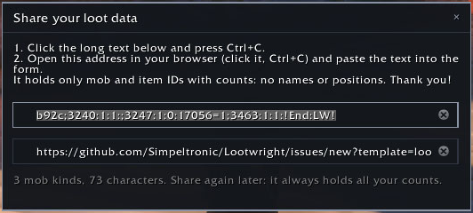
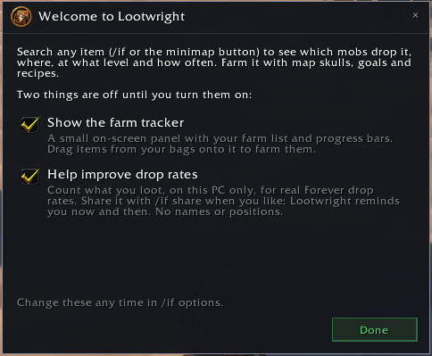

# Lootwright on CurseForge: page guide (0.9.0 beta)

Everything needed to put Lootwright on CurseForge: the images, the project settings, the description to paste, the screenshots to take, and how to set up Ko-fi and GitHub. Based on CurseForge's own rules and on how the most-downloaded WoW addon pages are built (Questie, Details!, WeakAuras, AtlasLoot, DBM). Sources are at the end.

Decided: **Ko-fi** for donations, a **public GitHub repo** for source and bug reports, first release **0.9.0 as a Beta file**, tagline **"Find any item. Farm what you need."**

---

## 1. Files in this kit

| File | Size | Use |
|---|---|---|
| `logo-400.png` | 400 × 400 | Project logo (avatar). The emblem on the dark panel. |
| `logo-crest.png` | 512 × 512 | The emblem alone, transparent. For GitHub and Ko-fi profile pictures. |
| `banner.png` | 1200 × 300 | First image of the description. |
| `divider.png` | 1200 × 24 | Optional section break. At most 2–3 times. |
| `screens/search-window.png` | 672 × 435 | Search tab (Gallery 1, inline under "Find where anything drops"). |
| `screens/map-skulls.png` | 648 × 434 | Grouped farm skulls in Hillsbrad Foothills (Gallery 2, inline). |
| `screens/amount-popup.png` | 1118 × 564 | The amount popup over the Search tab (Gallery 3, inline under "Farm with goals"). |
| `screens/mob-tooltip.png` | 410 × 160 | A mob tooltip with the green "Farm:" line (Gallery 4). |
| `screens/professions.png` | 868 × 564 | Professions tab with the Tailoring recipe list (Gallery 5). |
| `screens/farm-tab.png` | 868 × 564 | Farm tab with a recipe group and a crafted material opened up (Gallery 6, inline under "Farm a whole recipe"). |
| `screens/arrow.png` | 800 × 780 | The waypoint arrow pointing to a spawn, 407 yd away (Gallery 7). |
| `screens/tracker.png` | 294 × 164 | The farm tracker with a recipe group (Gallery 8, inline). |

All screenshots are real, cropped from 2560 × 1440 in-game shots, with no character names, chat or other addons' trackers.
| `page-preview.html` | | A preview of how the finished page reads. |

Images are drawn by `tools/make_brand.py` from the emblem (`tools/make_icons.py`), so they match the addon.

---

## 2. Logo and image rules

**CurseForge requires:** a square logo, at least 400 × 400, PNG (not WebP), not a plain colour, not a generic game logo, nothing copyrighted.

**Lootwright's rules**
- The logo is **the emblem only** (loot bag, dotted route, red X in a brass ring). No text: the name sits next to it everywhere.
- Don't stretch, recolour, outline or add glow to the emblem. Keep a quarter of its width free around it.
- Colours: background `#14171C`, panel `#1A1E25`, lines `#2F3540`, text `#D6DAE1`, muted `#8A93A3`, brass `#C9A24A`, green `#4FD36A`. Brass is the one warm accent; use it sparingly (one line, one highlight).
- Banner text is set in **Inter** (SIL Open Font License 1.1, from Google's font repository), kept in `tools/fonts/` with its licence. It's free to use in public images.

---

## 3. Page rules

**Copied from the top pages:** H1 and a badge row first, then one line saying what the addon is (all five do this). Short sections with headings, WeakAuras-style. A "Quick start" line. Screenshots in the Gallery with captions, plus a few inline under the main features (Questie). Credits at the bottom, licence in the sidebar. Donation link small and at the bottom: CurseForge requires donation banners to be "civil in size and at the bottom of the page".

**Avoided:** hype claims (Details!), hit counters, long link lists at the top (DBM), stale version info (AtlasLootClassic still lists 2023 versions). Update the page with every release.

**Style:** English first. H1 for the name only, H2 for sections, H3 for single features. Plain sentences in the player's words. Honest limits: normal-mob rates are Classic 1.12 numbers from CMaNGOS, and the page says so. ForeverDB's credit must stay visible (its licence requires it).

---

## 4. Project settings

| Field | Value |
|---|---|
| **Name** | Lootwright |
| **Summary** (one sentence) | Find which mobs drop any item, where and how often, then farm it with goals, map skulls and recipe material lists. |
| **Main category** | Professions |
| **Additional categories** | Map & Minimap, Tooltip, Bags & Inventory |
| **Licence** | GNU General Public License v3 (GPL-3.0) |
| **Game version** | WoW Forever (pick the flavour CurseForge lists for Forever when uploading) |
| **File** | `Lootwright-0.9.0.zip`, release type **Beta** |
| **Source** | https://github.com/Simpeltronic/Lootwright |
| **Issues** | https://github.com/Simpeltronic/Lootwright/issues |
| **Donation** | https://ko-fi.com/simpeltron (CurseForge has a donation field in the project settings; Ko-fi is one of the supported links) |

The upload is one `.zip` containing the three folders `Lootwright`, `Lootwright_Data` and `Lootwright_Professions`. The packaging step (Phase 10) builds it and leaves out `docs/`, `tools/`, `Art/` and the Markdown files.

---

## 5. Description (paste into the Markdown editor)

Replace `BANNER_URL`, `SEARCH_IMG_URL`, `POPUP_IMG_URL`, `MAP_IMG_URL`, `FARMTAB_IMG_URL`, `TRACKER_IMG_URL` (upload the images to the project's Images tab first, then copy their links). The live page loads them from GitHub instead (`https://raw.githubusercontent.com/Simpeltronic/Lootwright/main/docs/curseforge/screens/<file>`), and the two images added in 0.10.0 already use those links.

```markdown


# Lootwright

[](https://github.com/Simpeltronic/Lootwright) [](https://github.com/Simpeltronic/Lootwright/issues) 

**Find any item. Farm what you need.** Type an item's name and Lootwright shows every mob that drops it, where they are, what level they are and how often it drops. Put it on your farm list with a goal, and the mobs you need get marked on your map and tooltips until your bags hold enough.

Made for **WoW Forever**, with crafting materials front and centre.

## Features

### Find where anything drops
Search by name, or shift-click any item. See every mob that drops it with level (coloured by difficulty), rank, zone and drop rate, best rates first and your current zone on top. Filter by Reagents, Quest items, Gear, Other or Dungeon boss drops. Reagents show how many recipes use them, and items a recipe makes get a small blue **craft** tag.


### Farm with goals
Press **Farm…** on an item and choose how many you want, like splitting a stack: type a number, use the mouse wheel, or pick +10, +20 or a stack. Mobs that drop it get a "Farm:" line on their tooltip and a skull on the world map. When your bags hold enough, it leaves the list by itself. For something your profession can craft, **Farm…** adds its recipe instead, so you farm the materials.


### Farm a whole recipe
On the Professions tab, pick a recipe and press **Farm recipe**. Every material becomes a goal. Crafted materials (in blue) open up into what they're made from if you have the profession (Bolt of Linen Cloth into Linen Cloth), vendor-only materials are greyed out, and you get a message as each material is ready, and when you can craft. Items in your bank show in the count, `1(2) / 3`, with a lighter green on the bar.


### Map skulls and a waypoint arrow
Click a mob to mark all its spawns. Mobs you're farming get small grouped skulls with a count. Click any skull for an arrow and the distance to it.

### Farm tracker
A small panel that keeps your farm list on screen, bank counts included. Drag an item from your bags onto it to start farming it. Turn it on in the welcome window, with `/if mini` or in the options.


### Help work out real Forever drop rates (opt-in)
Most normal-mob rates today are rough Classic numbers. If you opt in, Lootwright counts what you loot, on your PC only, and once you've looted a mob 20 times its tooltip shows your own rate, and mobs that never drop the item go grey. Share your counts with `/if share` (copy, paste into a GitHub form) and they'll go into measured Forever rates for everyone. No names or positions are ever included.



### Also
- **Every recipe** for every profession, including ones you haven't learned, with how to learn them.
- **Honest numbers:** dungeon boss rates measured in Forever with their kill counts. Rates from very few kills are marked, and items with no known rate say so.
- **Many more mobs per item:** cloth and other common drops list every mob, not just the top 200.
- **Favourites and recent items** at your fingertips.
- **Minimap button** that works with minimap button collectors.

## Quick start

The first time you log in, a short welcome window lets you turn on the farm tracker and loot counting (`/if welcome` shows it again).



Type `/if` (or `/lootwright`), or click the minimap button. `/if options` opens the settings, `/if mini` toggles the farm tracker, `/if help` lists every command.

## Requirements

- **QuestieDB** (required): Lootwright reads item, mob and map data from it. You don't need Questie itself.

## Parts you can switch off

Untick what you don't need in the AddOns list:
- **Lootwright:** search, farm list, map, tooltips.
- **Lootwright - Data:** every recipe and dungeon boss loot. Loads only when needed.
- **Lootwright - Professions:** the Professions tab.

Single features (tooltip lines, map skulls, the arrow, messages, the minimap button, the tracker) can be switched in `/if options`.

## Good to know

- This is an **early version** (0.x), and WoW Forever itself is still in beta. Things may change between versions.
- Most drop rates for normal mobs are rough Classic 1.12 numbers from CMaNGOS, marked with ~, not measured in Forever. Drops under 1% and some items still show "rate unknown" rather than a guess.
- Open each of your profession windows once so Lootwright knows which recipes you have.

## Problems and ideas

Report bugs and ideas on [GitHub Issues](https://github.com/Simpeltronic/Lootwright/issues). If something breaks, type `/console scriptErrors 1`, do it again, and include the error text.

## Credits

- **Data from ForeverDB.net (https://foreverdb.net)**: recipes and dungeon boss loot with drop rates measured in WoW Forever.
- **QuestieDB** (https://github.com/Questie/QuestieDB): item, mob, spawn and map data.
- **Mob drop rates from CMaNGOS classic-db** (https://github.com/cmangos/classic-db, GPL-3.0): Classic 1.12 rates for normal mobs, shown when no better rate is known.

Lootwright is free software under the GPL-3.0 licence.

---

If Lootwright saves you some farming time, you can [support it on Ko-fi](https://ko-fi.com/simpeltron).
```

---

## 6. Setting up Ko-fi (about 10 minutes)

Ko-fi is a free "buy me a coffee" page. People tip any amount; there's no subscription and no fee from Ko-fi on one-off tips (PayPal or Stripe take their normal processing fee).

1. Go to ko-fi.com and sign up with an email. Choose a **page name**, for example "Lootwright" or your creator name. This becomes your link: `ko-fi.com/yourpagename`. It's what people see, not your real name.
2. Add a picture: use `logo-crest.png` from this kit.
3. Write a one-line "About": *"I make Lootwright, a farming and drop-finder addon for WoW Forever."*
4. Connect payouts under **Settings → Payments**: link your PayPal account (or Stripe). Tips go straight there.
5. Optional: turn off memberships and shop if you only want tips.
6. Your link is https://ko-fi.com/simpeltron (already filled in above).

Privacy note: the person tipping sees your Ko-fi page name. Depending on PayPal settings, your PayPal name or email can show on their receipt, so check the PayPal account's display name first.

---

## 7. Setting up GitHub

1. Sign in at github.com and create a **new public repository** named `Lootwright`. Don't add a README or licence there (the project already has them).
2. In the project folder, run (replace `YOURNAME`):

   ```
   git remote add origin https://github.com/YOURNAME/Lootwright.git
   git branch -M main
   git push -u origin main
   ```

3. Your links become https://github.com/Simpeltronic/Lootwright and `.../issues`.
4. Before pushing, decide about `Art/`: it's 12 MB of source art and not in git now. Leave it out, or add it on purpose.
5. In the repo's settings, turn on **Issues**.

---

## 8. Screenshot shot list (Gallery)

CurseForge wants real in-game screenshots. All eleven are in `screens/`, real and ready to upload. Settings for every shot: 1920 × 1080 or larger, default UI scale, daytime outdoor zone, PNG, other addons' frames hidden where they'd clutter, crop with a little game world around the subject.

| # | Shot | Caption | Status |
|---|---|---|---|
| 1 | Search tab with an item selected, Reagents pill on | Find every mob that drops an item, best rates first | `screens/search-window.png` |
| 2 | World map with small grouped farm skulls (press Clear pins first, so only farm skulls show) | Farm skulls on the map, grouped by area | `screens/map-skulls.png` |
| 3 | The amount popup open over the Farm button | Choose how many you want | `screens/amount-popup.png` |
| 4 | A mob hovered with the green "Farm: … (have 12/40)" line | Mobs you need are marked on their tooltip | `screens/mob-tooltip.png` |
| 5 | Professions tab with the recipe list | Every recipe, and what it takes to make it | `screens/professions.png` (no recipe selected; a retake with one selected would show its materials) |
| 6 | Farm tab with a recipe group, a crafted material opened up, a check mark | Farm a whole recipe, step by step | `screens/farm-tab.png` (retaken for 0.10.0: blue crafted material, bank count `1(2) / 3`) |
| 7 | The waypoint arrow on screen while walking to a spawn | Click a skull for an arrow to the spawn | `screens/arrow.png` |
| 8 | The farm tracker next to the quest tracker | Keep your farm list on screen | `screens/tracker.png` (retaken for 0.10.0: blue crafted rows, bank counts) |
| 9 | The welcome window with both options | Turn on what you want the first time you play | `screens/welcome.png` (0.10.0) |
| 10 | The Search list with blue craft tags | See at a glance what you can craft | `screens/search-craft.png` (0.10.0) |
| 11 | The share window | Share your loot to improve drop rates | `screens/share.png` (0.10.0) |
| - | A mob row tooltip with "You: 9 of 40 corpses" | Your own drop rate after 20 kills | not taken yet (needs 20 corpses of one mob) |

Use shot 1 as the first Gallery image: it's what shows in search results.

---

## 9. Release checklist

- [x] Ko-fi page made (https://ko-fi.com/simpeltron), link filled in.
- [x] GitHub repo made and pushed (https://github.com/Simpeltronic/Lootwright), link filled in, Issues on.
- [x] Banner font swapped for Inter (OFL), banner re-rendered.
- [x] Full GPL-3.0 text added as `LICENSE` (repo and every folder of the release zip).
- [x] Version set to 0.9.0 in all three TOCs and in `Core.lua`.
- [x] `tools/release.py` (rebuilds the data) run right before packaging (ForeverDB data 2026-11-18).
- [x] Release zip built with the three addon folders only: `python -I tools/package.py` writes `dist/Lootwright-0.9.0.zip` (25 files, 183 KB). Re-run both scripts if anything changes before upload.
- [ ] Logo, banner and screenshots uploaded; image links pasted into the description.
- [x] 0.9.0 uploaded as **Beta**.
- [ ] 0.10.0 uploaded as **Release** (Beta files are hidden in the CurseForge app unless players switch to the Beta channel; the version number and "early version" say it's early).

---

## Sources

- CurseForge, Project submission guide and tips: https://support.curseforge.com/en/support/solutions/articles/9000199552-project-submission-guide-and-tips
- CurseForge, Moderation policies: https://support.curseforge.com/en/support/solutions/articles/9000197279-moderation-policies
- CurseForge, Creating and submitting a project: https://support.curseforge.com/en/support/solutions/articles/9000197241-creating-and-submitting-a-project
- Reference pages: Questie, Details!, WeakAuras, AtlasLootClassic, Deadly Boss Mods (curseforge.com/wow/addons/…)
